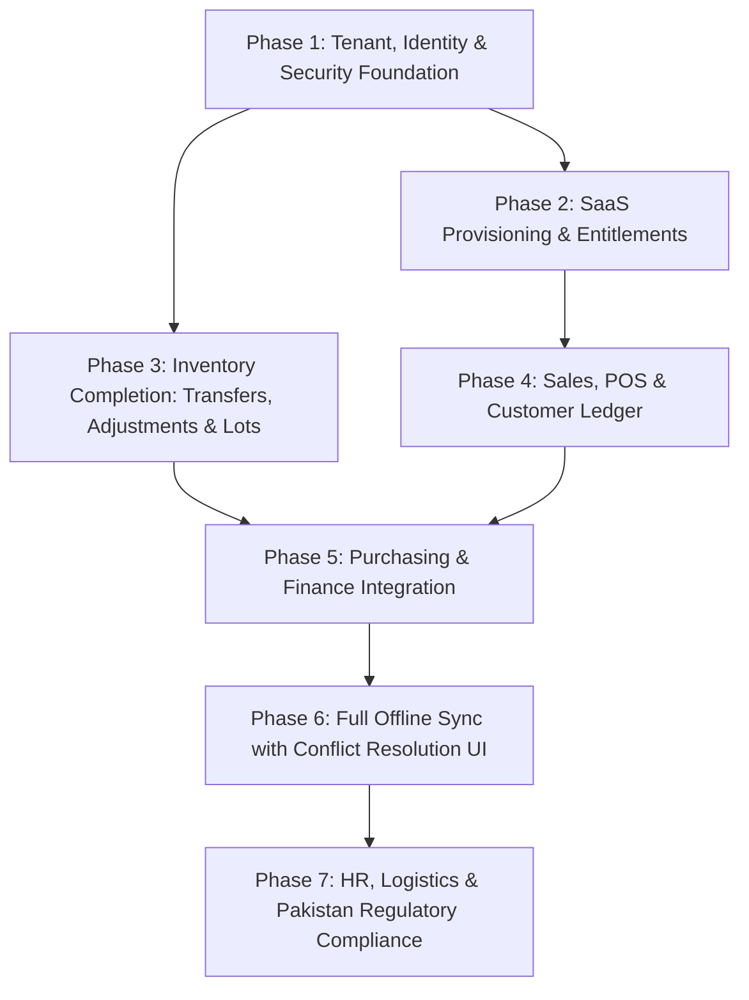

# Universal ERP Platform — Implementation Status
**Document Reference:** MASTER-ERP-001  
**Generated:** 1 November 2026 | Initial Market: Pakistan  

This document tracks the verified implementation status against the product specification and architectural blueprint defined in `MASTER-ERP-001`.

---

## 1. Verified Build & Test Status

| Component | Status | Details & Verification Command |
|---|---|---|
| **PostgreSQL Database** | **Operational** | Container `universal-erp-postgres` on port 5433 (healthy). Migrations `001_platform_foundation` through `019_purchasing_outbox_dead_letter` applied cleanly. Verified via live end-to-end API script, 15 offline receipt sync integration tests, and 7 purchasing outbox integration tests. |
| **Backend Core (.NET 10)** | **Builds Cleanly** | `dotnet build UniversalErp.sln`: 5 projects compiled with 0 Warnings, 0 Errors (`UniversalErp.Domain`, `UniversalErp.Application`, `UniversalErp.Infrastructure`, `UniversalErp.Api`, `UniversalErp.Api.Tests`). |
| **Backend Tests** | **Verified (85/85 Passing)** | `dotnet test UniversalErp.sln`: 85 passed, 0 failed. Tests cover tenant code/email normalization & validation, idempotency hash matching, duplicate conflict detection, plan entitlement resolution, security context bypass protection, double-entry balance verification, trial balance aggregation, stock transfer bin constraints, adjustment reason codes and negative balances, supply chain outbox processing, customer creation and validation, sales order draft & confirmation lifecycle, sales invoice / POS idempotency and insufficient stock handling, 18 offline sync resilience unit tests, 15 PostgreSQL-backed offline receipt sync integration tests, and 7 PostgreSQL-backed purchasing outbox integration tests (`PostgresSupplyChainOutboxIntegrationTests` covering retry deduplication, poison event isolation, exponential backoff with jitter and durable sanitized error recording, dead-letter state transition after 5 attempts, dead-letter redrive, concurrent worker safety with `FOR UPDATE SKIP LOCKED`, and direct dead-letter on malformed or unsupported event payloads). |
| **Web Client (React + TS)** | **Builds Cleanly** | `npm run build` completed cleanly (`tsc -b && vite build` bundled in 6.53s, 39 modules transformed, 0 errors). Includes `TenancyWorkspace` for SaaS onboarding, `FinanceWorkspace` for Chart of Accounts/Journals/Trial Balance, `InventoryWorkspace` with Stock Transfers, Adjustments, and non-truncating actionable offline receipt conflict cards ("Copy to form" / "Retry sync"), `PurchasingWorkspace` with real-time Outbox synchronization, and `SalesWorkspace` with Point of Sale counter register, sales orders, customer directory, and invoices ledger. |
| **Windows Desktop** | **Missing** | Shell folder only. Implementation deferred to client rollout phase. |
| **Android Mobile** | **Scaffold Only** | Gradle project and AndroidManifest present; no operational sync workflows implemented. |

---

## 2. Module-by-Module Assessment Against MASTER-ERP-001

### 4.1 SaaS Platform & Tenant Management
- **Implemented & Verified:**
  - Database schema for tenants, subscription plans, plan features, subscriptions, items, entitlements, and usage metering (`platform.*`).
  - Migration `012_saas_tenant_onboarding.sql` prepared (default plans `starter`, `professional`, `enterprise`, feature entitlements, `tenant_provisioning_jobs`, least-privilege grants to `erp_app`).
  - `TenantOnboardingService` and `PostgresTenantOnboardingRepository` implementing atomic tenant registration, initial company, headquarters warehouse location, admin user, default `tenant_admin` role assignment, plan entitlement snapshotting, provisioning job tracking, and audit event recording.
  - Endpoints `POST /api/v1/tenants/register`, `GET /api/v1/tenants/{tenantId}`, `GET /api/v1/tenants/by-code/{tenantCode}`, `GET /api/v1/plans`.
  - Comprehensive unit test suite (`TenantOnboardingServiceTests`) validating input validation, slug format, email RFC/TLD validation, idempotency hash checking, and duplicate conflict handling.
  - Web UI `TenancyWorkspace.tsx` wired into React client for self-serve tenant registration and plan exploration.
- **Live Verification:** Migration `012_saas_tenant_onboarding.sql` applied to local PostgreSQL container. End-to-end integration verified: tenant creation, plan feature snapshots, idempotent replays, conflict checks, and queries.
- **Missing:** Stripe/JazzCash/Easypaisa payment webhook listener for recurring billing; tenant data closure/export worker.

### 4.2 Identity & Security
- **Implemented & Verified:** Database schemas (`identity.*`, `authorization.*`, `audit.*`), PostgreSQL Row-Level Security (RLS) policies with fail-closed enforcement, bearer token validation, and database permission policy check handlers.
- **Implemented but not verified:** Production OIDC issuer setup (documentation provided in `PRODUCTION-OIDC-SETUP.md`).
- **Missing:** User invitation UI, phone OTP provider adapter, privilege elevation/support grant auditing, multi-factor authentication enforcement.

### 4.3 Organization Structure
- **Implemented & Verified:** `organization.companies`, `organization.company_groups`, `organization.locations`, with composite tenant-safe keys and RLS.
- **Scaffold / Incomplete:** Hierarchy management APIs, branch/department operational views.

### 4.4 Catalog & Inventory
- **Implemented & Verified:**
  - Product catalog (`erp_inventory.product`), units of measure, untracked variants (`erp_inventory.product_variant`), warehouses, bins.
  - Idempotent stock receipt posting (`erp_inventory.inventory_movement`, legs, and `stock_balance` projection update).
  - Multi-warehouse stock transfers with two-legged movements (decrement source bin, increment destination bin, insufficient stock validation, source/dest bin difference assertion).
  - Stock adjustments (positive delta, negative write-off delta with insufficient stock checks, reason code validation).
  - Outbox events (`erp_inventory.outbox_event`) and change log auditing.
  - Web UI for products, units, variants, warehouses, bins, receipt posting, stock transfers, and stock adjustments.
- **Incomplete / Missing:** Stock reservation lifecycle, lot/batch/serial tracking, weighted-average and periodic FIFO costing revaluation.

### 4.5 Offline-First Synchronization
- **Verified:**
  - Local device storage using browser AES-GCM encrypted IndexedDB journals for products and receipts with per-device non-exportable CryptoKey.
  - Client-side durable operation ID generation with retry safety (idempotency). Replay returns duplicate receipt without duplicate movement or GL posting.
  - Server-side durable synchronization schema (`sync.operation_inbox`, `sync.change_log`, `sync.company_change_counters`, `sync.offline_grants`, `sync.device_company_scopes`).
  - Migration `017_offline_sync_hardening.sql`: lease tracking columns (`claim_token`, `claimed_at`, `claim_expires_at`), lease index, and warehouse location binding constraint applied cleanly.
  - Migration `018_command_idempotency_company_scope_and_conflicts.sql`: added `company_id` to `command_idempotency` and created durable conflict store `sync.operation_conflicts`.
  - Atomic single-transaction execution (`ProcessReceiptOperationAtomicAsync`): inventory posting, ledger leg writes, stock balance, change feed publication, outbox event, and inbox outcome committed atomically in PostgreSQL.
  - Claim token matching on inbox acceptance and terminal rejection (`AND claim_token = @token AND outcome = 'deferred'`), asserting `affected == 1` and throwing on failure to force automatic transaction rollback.
  - Effective location restrictions: warehouse UUID is strictly separated from location UUID, validating `warehouse.location_id` against authorized scopes without fallback to warehouse UUID.
  - Command idempotency conflict protection: `command_idempotency` checked `FOR UPDATE` before writes; mismatches in `command_code`, `request_hash`, or `company_id` reject with `COMMAND_IDEMPOTENCY_CONFLICT` without overwriting `resource_id`.
  - Durable sequence conflict preservation: sequence collisions logged in `sync.operation_conflicts` with `conflicting_operation_id` without mutating the original accepted inbox record.
  - Strict authorization revocation policy: row-level shared locks (`FOR SHARE OF device, company_scope, membership, offline_grant`) and advisory serialization prevent in-flight bypass of credential or scope revocations.
  - Durable claim & crash-recoverable lease behavior: operations reserved with 30s leases. Active leases prevent concurrent workers from racing; expired leases are safely recovered upon retry.
  - Terminal outcome immutability: accepted, rejected, and conflict states can never be reverted back to a processing state.
  - Gapless, monotonic cursor allocation via `sync.company_change_counters` row lock; concurrent transactions serialize without gaps; rollback resets counter.
  - Commit-ordered cursor pagination (`sync.change_log.company_sequence`) for incremental downloads (`GET /api/v1/sync/changes/*`).
  - Audit and change feed publications for Products, Inventory Receipts, Inventory Transfers, Inventory Adjustments, and Sales Invoices.
  - Snapshot persistence with atomic in-transaction monotonic cursor validation (`saveInventorySnapshotAndCursors`) preventing stale snapshot rollback.
  - Multi-layer authorization & effective location restrictions: tenant, company, device, user membership, grant, warehouse, bin, and device/grant location restrictions enforced server-side.
  - Device and company scope revocation defense: revoked devices or company scopes cannot self-reactivate on renewal.
  - Grant expiration renewal with automatic re-registration and immediate retry on HTTP 401/403.
  - Elimination of dead dev-mode batch endpoints (`/api/v1/sync/operations:batch`) in favor of authenticated single-operation sync.
  - Concurrent stock movement resilience: simultaneous submissions of identical operation IDs post exactly once; simultaneous identical device sequences return `DEVICE_SEQUENCE_REUSED`.
  - Comprehensive unit test suite (18 unit resilience tests in `OfflineSyncServiceTests.cs`).
  - Real PostgreSQL concurrency & crash-recovery integration test suite (13 tests in `PostgresOfflineReceiptSyncIntegrationTests.cs`).
  - Live end-to-end sync verification in `verify-api.ps1`: live device registration, receipt batch upload, lost-acknowledgement replay, and incremental change feed download verified against PostgreSQL (32 events, cursor 59).
- **Implemented but not verified:**
  - Sales order change log publication: draft orders stored in `erp_sales.sales_order` but change feed publication not yet integrated.
  - Purchasing GRN change log publication: movements publish via inventory movement leg change log, but GRN header does not yet write directly to `sync.change_log`.
- **Open:**
  - Optimistic Concurrency Control (`base_version` OCC) across all editable entities.
  - Sales Orders and POS offline queue with explicit conflict resolution screen.
  - Native desktop (Windows) and mobile (Android) SQLite encrypted local journals.
  - Change log automated retention pruning and archival.

### 4.6 Purchasing
- **Implemented & Verified:**
  - Schema (`erp_purchasing.supplier`, `purchase_order`, `purchase_order_line`, `goods_received_note`, `goods_received_note_line`, `outbox_event`).
  - Migrations `011_purchasing` and `019_purchasing_outbox_dead_letter` applied cleanly.
  - Repository, application service, and API endpoints for suppliers, draft/confirmed POs, idempotent GRN posting, and dead-letter redrive.
  - Supply Chain Outbox processor (`ISupplyChainOutboxRepository`, `PostgresSupplyChainOutboxRepository`, `SupplyChainOutboxService`):
    - Atomic per-event transactions: each event executes in its own database transaction; failing/poison events roll back independently and do not block healthy events.
    - Concurrent worker protection: pending events claimed via `FOR UPDATE SKIP LOCKED`.
    - Automatically consumes `grn.posted` events, posts inventory receipt movements, updates stock balances, and posts balanced double-entry General Ledger journal entries (Debit: 1200 Merchandise Inventory Asset, Credit: 2010 Accounts Payable).
    - Deduplication: checks for existing movement and journals; safe on retry.
    - Exponential backoff with jitter: $2^{\text{attempt}-1} \times 2.0\text{s}$ (cap 300s, 0–25% random jitter) with durable sanitized `last_error` and `next_retry_at`.
    - Max 5 retry attempts, after which events transition to `status = 'dead_letter'`; never sets `published_at` on failure.
    - Direct dead-letter transition for malformed empty payloads or unsupported event types.
    - Dead-letter redrive API (`POST /api/v1/purchasing/outbox/redrive`) and repository method resetting `status = 'pending'`, `attempt_count = 0`, `next_retry_at = now()`, recording `last_redriven_at = now()`, and incrementing `redrive_count`.
  - Web client `PurchasingWorkspace` tabbed workflow with Outbox sync action.
- **Incomplete / Missing:** Three-way purchase invoice matching; supplier debit notes and returns.

### 4.7 Finance & Accounting
- **Implemented & Verified:**
  - Migrations `013_double_entry_accounting.sql` and `014_finance_chart_of_accounts_seed.sql` applied cleanly.
  - Currencies (`PKR`, `USD`, `EUR`, `GBP`, `AED`, `SAR`), fiscal years, and fiscal periods.
  - Standard Pakistani / Universal Chart of Accounts (Assets, Liabilities, Equity, Revenue, COGS, Operating Expenses).
  - Strict database constraint triggers (`assert_posted_journal_balanced`) ensuring debit-credit equality and immutable posted journal lines (`reject_posted_journal_line_mutation`).
  - Strict tenant and company Row-Level Security (`tenant_company_scope` on `finance.*`).
  - Application contracts, `FinanceService`, and `PostgresFinanceRepository` implementing accounts creation, fiscal period management, idempotent double-entry journal posting, and real-time trial balance calculation.
  - REST endpoints: `GET/POST /api/v1/finance/accounts`, `GET /api/v1/finance/years`, `GET /api/v1/finance/periods`, `GET/POST /api/v1/finance/journals`, `GET /api/v1/finance/trial-balance`.
  - Comprehensive unit test suite in `FinanceServiceTests.cs` (unbalanced journal rejection, minimum 2 lines requirement, account code conflict checks).
  - Live end-to-end integration verified: balanced journal posting (Rs 75,000 debit / credit), unbalance rejection (422 Unprocessable Entity), and trial balance proof.
  - Interactive Web client `FinanceWorkspace.tsx` wired into React application.
- **Incomplete / Missing:** Multi-currency exchange rate revaluation; accounts payable / receivable subledger invoice matching; automated depreciation runs.

### 4.8 Sales & Point of Sale (POS)
- **Implemented & Verified:**
  - Database schema (`erp_sales.customer`, `sales_order`, `sales_order_line`, `sales_invoice`, `sales_invoice_line`, `outbox_event`) created via migration `015_sales_and_pos.sql`.
  - Default walk-in retail customer seeded via `016_sales_seed.sql`.
  - Full PostgreSQL Row-Level Security (RLS) policies isolating sales records by `tenant_id` and `company_id`.
  - Customer directory with credit limit, customer types (`retail`, `wholesale`, `distributor`, `corporate`), payment terms, and outstanding balances.
  - Sales Orders with draft and confirmation lifecycle (`draft` -> `confirmed`).
  - POS / Sales Invoices with client-side idempotency keys (`clientTransactionId`), supporting multiple payment methods (`cash`, `credit`, `bank_transfer`, `card`, `mobile_wallet`).
  - Automated atomic inventory relief: checks stock availability with row-level locks (`FOR UPDATE`), throws `INSUFFICIENT_STOCK` if on-hand quantity is less than ordered, records `inventory_movement` of type `'issue'`, and updates `stock_balance`.
  - Automatic customer ledger updates (credit sales increment `outstanding_balance`).
  - Automated balanced double-entry General Ledger journal generation:
    - Debit `1010 Cash` / `1020 Bank` / `1100 AR`
    - Credit `4010 Product Sales Revenue` (net of discount)
    - Credit `2100 Sales Tax Payable` (if tax > 0)
    - Debit `5010 Cost of Goods Sold` (if cost > 0)
    - Credit `1200 Merchandise Inventory Asset` (if cost > 0)
  - Unit tests in `SalesServiceTests.cs` (8 test cases covering customer validation, orders, POS posting, stock insufficiency, duplicate idempotency replay).
  - Live end-to-end integration test in `verify-api.ps1`:
    - Customer creation (`CUST-METRO-01`)
    - Sales order creation and confirmation
    - Cash POS sale of 5 EA with 18% sales tax $\rightarrow$ relieves Karachi stock from 38 to 33 EA
    - Credit sale of 3 EA $\rightarrow$ updates customer balance to Rs 4,800, relieves Karachi stock to 30 EA
    - Insufficient stock rejection verified (attempting to sell 100 EA returns HTTP 422)
    - Idempotent invoice replay verified (returns existing invoice without deducting stock twice)
    - General Ledger double-entry mathematical balance verified: final Trial Balance balanced at Rs 110,250.
  - Interactive React Web client workspace `SalesWorkspace.tsx` supporting POS checkout, sales orders, customer directory, and invoices ledger.
- **Incomplete / Missing:** Physical receipt thermal printer ESC/POS integration; cash drawer shift open/close reconciliation.

### 4.9 HR & Payroll
- **Missing:** Employee master data, shifts, attendance, payroll components, and statutory deductions.

### 4.10 Pakistan Localization
- **Implemented & Verified:** PKR default currency, `Asia/Karachi` timezone defaults, bilingual English/Urdu starter UI layout.
- **Blocked / External:** FBR digital invoicing adapter requires licensed integrator credentials and official taxpayer compliance review.

---

## 3. Dependency-Aware Implementation Roadmap

---

## 4. Completed Phase 1 Milestones

1. **Tenant Onboarding & Provisioning Vertical Slice:**
   - Completed `TenantOnboardingContracts.cs` (`RegisterTenantRequest`, `TenantDetail`, `InitialCompanyDetail`, `TenantSubscriptionDetail`, `TenantEntitlementDetail`, `SubscriptionPlanDetail`).
   - Implemented `TenantOnboardingService` with input normalization, slug validation (`^[a-z0-9][a-z0-9-]{1,48}[a-z0-9]$`), email RFC/TLD validation, and SHA256 canonical payload hashing for idempotency verification.
   - Implemented `PostgresTenantOnboardingRepository` executing an atomic transaction:
     - Check `platform.tenant_provisioning_jobs` for duplicate key; replaying with identical payload returns existing tenant idempotently, conflicting payload throws `TenantIdempotencyConflictException`.
     - Checks duplicate `tenant_code` and `email_normalized`.
     - Inserts `platform.tenants`, sets RLS session scope, inserts `platform.subscriptions`.
     - Snapshots features from `platform.plan_features` into `platform.tenant_entitlements`.
     - Inserts initial `organization.companies` and headquarters warehouse `organization.locations`.
     - Inserts administrator into `identity.users` and establishes active memberships in `identity.tenant_memberships` and `identity.company_memberships`.
     - Creates system role `tenant_admin` in `"authorization".roles` and assigns it via `"authorization".membership_role_assignments`.
     - Records provisioning job in `platform.tenant_provisioning_jobs` and audit event in `audit.audit_events`.
   - Exposed REST endpoints in `TenantEndpointMappings.cs`:
     - `POST /api/v1/tenants/register` (requiring `Idempotency-Key` header).
     - `GET /api/v1/tenants/{tenantId}`.
     - `GET /api/v1/tenants/by-code/{tenantCode}`.
     - `GET /api/v1/plans`.
   - Excluded public onboarding endpoints (`/api/v1/tenants/register`, `/api/v1/plans`) from requiring pre-existing tenant context headers in `AuthenticatedTenantContextMiddleware`.
2. **Automated Verification:**
   - Integrated `UniversalErp.Api.Tests` into `UniversalErp.sln`.
   - Added 25 unit and security tests in `TenantOnboardingServiceTests.cs` and `SecurityMiddlewareTests.cs`.
   - `dotnet test UniversalErp.sln` passes with 25/25 successful tests.
3. **Web Client Integration:**
   - Added `TenancyWorkspace.tsx` and wired it into `App.tsx`.
   - `npm --prefix "universal-erp-core\src\web" run build` compiles with 0 errors.

---

## 5. Completed Phase 2 Milestones: Finance & General Ledger

1. **Database Schema & Migrations:**
   - Applied migration `013_double_entry_accounting.sql`:
     - Multi-currency table (`PKR`, `USD`, `EUR`, `GBP`, `AED`, `SAR`).
     - Fiscal years and fiscal periods with status constraints (`open`, `soft_closed`, `closed`).
     - Chart of Accounts with account types, normal balance (`debit`/`credit`), control accounts.
     - General ledger journals and journal lines.
     - Database-enforced balance triggers (`assert_posted_journal_balanced`) ensuring debits equal credits before commit.
     - Line immutability trigger (`reject_posted_journal_line_mutation`) on posted journals.
     - Row-level security on all financial tables.
   - Applied migration `014_finance_chart_of_accounts_seed.sql`:
     - Initialized `FY2026-27` and 6 monthly periods for development company.
     - Seeded 12 standard Chart of Accounts (Cash, Bank, AR, Inventory Asset, AP, Sales Tax, Capital, Retained Earnings, Sales, COGS, Rent, Salaries).
2. **Backend Application & Infrastructure:**
   - Implemented `FinanceContracts.cs`, `IFinanceRepository`, `FinanceService`, and `PostgresFinanceRepository`.
   - Exposed endpoints in `FinanceEndpointMappings.cs`:
     - `GET /api/v1/finance/accounts`, `POST /api/v1/finance/accounts`
     - `GET /api/v1/finance/years`, `GET /api/v1/finance/periods`
     - `GET /api/v1/finance/journals`, `GET /api/v1/finance/journals/{journalId}`
     - `POST /api/v1/finance/journals` (balanced double-entry with UUID idempotency key)
     - `GET /api/v1/finance/trial-balance`
3. **Automated & Live Verification:**
   - 29/29 tests passing across `UniversalErp.sln`.
   - Live end-to-end API test script `verify-api.ps1` confirmed:
     - 12 active accounts loaded.
     - Unbalanced journal rejected with HTTP 422 Unprocessable Entity.
     - Balanced journal (Rs 75,000 debit & credit) committed and posted to ledger.
     - Trial Balance mathematically confirmed balanced (`Debits == Credits`).
4. **Web Client Integration:**
   - Implemented `FinanceWorkspace.tsx` with Chart of Accounts viewer/creator, interactive balanced double-entry journal entry form with real-time balance proof checker, journal entries ledger, and real-time Trial Balance report.
   - `npm --prefix "universal-erp-core\src\web" run build` succeeded with 0 errors.

---

## 6. Completed Phase 3 Milestones: Inventory Transfers, Adjustments & Supply Chain Outbox Automation

1. **Inventory Movements & Transfers:**
   - Implemented `PostInventoryTransferRequest` and `PostInventoryAdjustmentRequest` contracts in `InventoryWorkflowService.cs`.
   - Implemented `PostTransferAsync` in `PostgresInventoryWorkflowRepository.cs`:
     - Enforces UUID idempotency with canonical request hashing.
     - Validates active product variant and source location stock sufficiency.
     - Rejects transfers where source and destination bins are identical (`SOURCE_AND_DESTINATION_BIN_MUST_DIFFER`).
     - Atomically records 2-legged movement (negative delta on source bin, positive delta on destination bin).
     - Decrements source on-hand stock and upserts destination on-hand balance.
     - Emits `inventory.transfer.posted` outbox event and appends to change log.
   - Implemented `PostAdjustmentAsync` in `PostgresInventoryWorkflowRepository.cs`:
     - Enforces non-zero delta and standard reason codes (`cycle_count`, `damaged_goods`, `theft_or_loss`, `correction`).
     - Validates that negative adjustments do not drop available stock below zero.
     - Atomically records adjustment movement and updates stock balance.
     - Emits `inventory.adjustment.posted` outbox event.
   - Exposed endpoints in `InventoryEndpointMappings.cs`:
     - `POST /api/v1/inventory/transfers`
     - `POST /api/v1/inventory/adjustments`

2. **Supply Chain Outbox Automation (Purchasing GRN → Inventory Movements & GL Accounting):**
   - Implemented `ISupplyChainOutboxRepository`, `PostgresSupplyChainOutboxRepository`, and `SupplyChainOutboxService`.
   - Consumes pending events from `erp_purchasing.outbox_event` under PostgreSQL transaction locks (`FOR UPDATE SKIP LOCKED`).
   - Implements per-event transactions: each event executes in its own database transaction; failing/poison events roll back without affecting healthy events.
   - Automatically generates `erp_inventory.inventory_movement` and movement legs for each GRN line, updating `erp_inventory.stock_balance`.
   - Automatically posts a balanced double-entry General Ledger journal into `finance.journals` and `finance.journal_lines`:
     - **Debit:** Account `1200` Merchandise Inventory Asset
     - **Credit:** Account `2010` Accounts Payable (Trade Creditors)
     - Validated by deferred trigger `assert_posted_journal_balanced`.
   - On success: marks `status = 'published'`, `published_at = now()`, and commits.
   - On error: rolls back the event transaction, then opens an independent transaction to record `attempt_count + 1`, `next_retry_at` (exponential backoff $2^{\text{attempt}-1} \times 2.0\text{s}$ with 0-25% jitter, max 300s), and sanitized `last_error`. If attempts reach 5 (or for fatal non-retriable payloads), transitions to `status = 'dead_letter'`.
   - Provides dead-letter redrive API (`POST /api/v1/purchasing/outbox/redrive`) and repository method resetting `status = 'pending'`, `attempt_count = 0`, `next_retry_at = now()`, recording `last_redriven_at = now()`, and incrementing `redrive_count`.
   - Exposed endpoints `POST /api/v1/purchasing/outbox/process` and `POST /api/v1/purchasing/outbox/redrive`.

3. **Web Client Integration:**
   - Updated `InventoryWorkspace.tsx` with dedicated forms and cards for:
     - "Transfer stock" (variant, source warehouse/bin, destination warehouse/bin, quantity, note).
     - "Stock adjustment" (variant, warehouse/bin, +/- delta, reason code, note).
   - Updated `PurchasingWorkspace.tsx` with real-time "Sync Outbox to GL" action.
   - `npm run build` succeeds cleanly in 3.79s (0 warnings, 0 errors).

4. **Automated & End-to-End Live Verification:**
   - 37 unit tests passing across `UniversalErp.sln` (including `InventoryWorkflowServiceTests` and `SupplyChainOutboxServiceTests`).
   - Live end-to-end integration verified against local Docker PostgreSQL container on port 5433 via `verify-api.ps1`:
     - Initial stock receipt of 50 EA verified into Karachi hub.
     - Stock transfer of 20 EA from Karachi to Lahore verified (KHI: 30 EA, LHR: 20 EA).
     - Stock adjustment of -2 EA damaged goods write-off verified (KHI: 28 EA).
     - Supplier and PO creation, confirmation, and GRN posting of 10 EA at Rs 1,200/EA verified.
     - Supply Chain Outbox processor automatically updated Karachi stock balance to 38 EA (28 + 10).
     - General Ledger journal automatically posted for Rs 12,000 (Debit: 1200, Credit: 2010).
     - Real-time Trial Balance confirmed mathematically balanced at Rs 87,000 (`Debits == Credits`).

---

## 7. Next Phase: Phase 4 (Sales Orders, POS, and Customer Accounts Receivable)

1. **Customer Master & Credit Limits:**
   - Customer schema (`sales.customers`, customer groups, credit limits, NTN/STRN tax numbers).
2. **Sales Orders & Point of Sale (POS):**
   - Sales order creation, pricing rules, discounts, and item tax calculation.
   - Cash and credit POS checkout workflows with cash drawer session management.
3. **Automated Inventory Relief & Revenue Accounting:**
   - Outbox processing for Sales Invoices to relieve stock (`inventory_movement` of type `dispatch`).
   - Automated double-entry GL posting:
     - Debit: `1100 Accounts Receivable` or `1010 Cash on Hand`
     - Credit: `4010 Product Sales Revenue`
     - Debit: `5010 Cost of Goods Sold (COGS)`
     - Credit: `1200 Merchandise Inventory Asset`
